# The project explained: finding failures in supercomputer logs with LogBERT and a rule-guided LLM

**CSCI 390 Natural Language Processing and Applications · Dr. Qi Li**

This guide explains the whole project from first principles: the problem, every NLP idea it uses,
how the two approaches work inside, what the results mean, and what every file in the repository
does. It is written so that you can learn the project from scratch and then present it. The
diagrams are Mermaid diagrams (GitHub draws them), and the charts are drawn from the real run by
`scripts/make_figures.py`, so every number here can be traced to `results/`.

| Part | What you will learn |
|---|---|
| [1. The problem](#part-1--the-problem) | what a system log is, what "anomaly detection" means, the research question, and why it is an NLP problem |
| [2. From raw lines to windows](#part-2--from-raw-lines-to-windows-the-data-pipeline) | the BGL dataset, removing the label, Drain templates, the chronological split, sliding windows, and how the log changes over time |
| [3. Approach A: LogBERT](#part-3--approach-a-logbert) | embeddings, Transformers, self-attention, BERT's masked-word training, the hypersphere, detection, and what happens inside the trained model |
| [4. Approach B: the rule-guided LLM](#part-4--approach-b-the-rule-guided-llm) | large language models, prompting, rule induction, verification, the four conditions, and whether the LLM really follows the rules |
| [5. Evaluation and results](#part-5--evaluation-and-results) | precision, recall and F1, the fair-comparison setup, the results, error analysis and the conclusion |
| [6. The code, file by file](#part-6--the-code-file-by-file) | how the repository is organised and what every file does |
| [7. Running it yourself](#part-7--running-it-yourself) | the commands, from a one-minute check to the full run and the demo |
| [8. Presenting it](#part-8--presenting-it) | the storyline of the talk, likely questions, and a glossary |

---

## Part 1 — The problem

### 1.1 What a system log is

Every large computer writes a line of text whenever something happens: a job starts, a disk is
mounted, a memory chip corrects an error, a node crashes. These lines are **system logs**. When
something breaks, operators read them to find out what went wrong. A supercomputer writes millions
of lines a week, so no person can read them all.

Our data comes from **BlueGene/L (BGL)**, a supercomputer at Lawrence Livermore National Laboratory.
Here is a real line:

```text
KERNDTLB 1118536327 2005.06.11 R30-M0-N9-C:J16-U01 2005-06-11-17.32.07.581048 R30-M0-N9-C:J16-U01 RAS KERNEL FATAL data TLB error interrupt
```

Every line has ten fields separated by spaces:

| # | Field | In the example | Meaning |
|---|---|---|---|
| 1 | **Alert tag** | `KERNDTLB` | `-` for a normal message; otherwise the category of alert the administrators assigned. **This is the label.** |
| 2 | Epoch | `1118536327` | the time in seconds since 1 January 1970 |
| 3 | Date | `2005.06.11` | the day |
| 4 | Node | `R30-M0-N9-C:J16-U01` | which piece of hardware wrote the line (rack, midplane, node card, chip) |
| 5 | Time | `2005-06-11-17.32.07.581048` | the full time stamp |
| 6 | Node (repeat) | `R30-M0-N9-C:J16-U01` | the same node again |
| 7 | Type | `RAS` | reliability, availability and serviceability event |
| 8 | Component | `KERNEL` | the software part that wrote it |
| 9 | Level | `FATAL` | severity: `INFO`, `WARNING`, `SEVERE`, `ERROR`, `FATAL`, `FAILURE` |
| 10 | **Content** | `data TLB error interrupt` | the free-text message, everything after field 9 |

A normal line looks the same, except that its first field is `-`:

```text
- 1117838570 2005.06.03 R02-M1-N0-C:J12-U11 2005-06-03-15.42.50.675872 R02-M1-N0-C:J12-U11 RAS KERNEL INFO instruction cache parity error corrected
```

### 1.2 What log anomaly detection is

**Log anomaly detection** means deciding automatically whether a part of the log signals a problem.
In BGL the system administrators marked every alert message, so we know the truth: 348,460 of the
4,747,963 messages (7.3%) are alerts. Following LogBERT, we judge the log in **5-minute windows**: a
window is *anomalous* if it contains at least one alert. "Anomalous" is the positive class: the thing
we want to find.

Why it is hard:

1. **Volume.** Millions of lines, most of them routine.
2. **Rarity.** A detector that always answers "normal" is right 92.7% of the time on messages, and
   useless. That is why we measure precision and recall instead of accuracy (Part 5).
3. **Change.** Software is updated, jobs change, and new kinds of messages appear. A model trained on
   last month's log meets messages it has never seen (Section 2.6).
4. **Words can mislead.** `instruction cache parity error corrected` contains "error" but is normal
   (the hardware fixed itself). `ciod: LOGIN chdir(...) failed: Input/output error` looks like a
   routine failure but was an alert.

### 1.3 The research question and the two approaches

> **How does a BERT-style model that learns patterns in *sequences of log-template IDs* (LogBERT;
> Guo et al., 2021) compare with a *rule-guided large language model that reads the log text itself*
> (inspired by LogRules; Huang et al., 2025) in identifying anomalous system events?**

The two approaches look at the same log in very different ways:

<!-- diagram: two-approaches -->
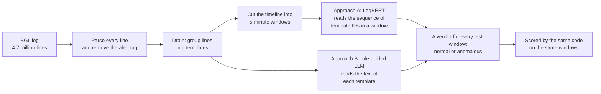

| | Approach A: LogBERT (reproduction) | Approach B: rule-guided LLM (partial LogRules adaptation) |
|---|---|---|
| Paper | Guo, Yuan & Wu (2021), *LogBERT: Log anomaly detection via BERT* | Huang, Zhang & Zhao (2025), *LogRules*, Findings of NAACL |
| Reads | sequences of template IDs; never the words | the words of each template; never the sequence |
| Learns from | **normal** training windows only (it never sees an alert) | **labelled** training templates, from which an LLM writes rules |
| Model | a small Transformer (1.67 million parameters) trained from scratch | Qwen2.5-7B-Instruct (7.6 billion parameters), used as it is, no training |
| Decides | a window is anomalous if the model fails to predict too many of its masked keys | the LLM (or plain keyword matching) labels each template; a window is anomalous if any message in it is labelled abnormal |

The published papers cannot answer the question: they use different data samples and different
evaluation units. (DeepLog, for example, scores F1 86.12 on BGL in the LogBERT paper but 16.8 in the
LogRules paper.) So this project re-runs both approaches **under one shared setup**: the same data,
the same chronological split, the same test windows, and the same evaluation code.

### 1.4 Why this is an NLP project

Logs are text written by programs. Each NLP idea in the course has a counterpart here:

| NLP idea | In this project |
|---|---|
| Tokenisation and a vocabulary | Drain turns each message into a *template*; each template gets an ID (a *log key*), and the set of keys is LogBERT's vocabulary |
| A sentence | a window: the sequence of log keys printed in 5 minutes |
| Word embeddings | LogBERT learns a 256-number vector for every log key |
| Transformers and self-attention | LogBERT's encoder: every position looks at every other position |
| BERT's masked language modelling | LogBERT hides half of the keys and learns to predict them (*masked log key prediction*) |
| Large language models | Qwen2.5-7B-Instruct reads the template text and answers in JSON |
| Prompting: zero-shot, few-shot, instructions | Approach B's conditions B1-B3 |
| Text classification | both approaches classify windows (A) or templates (B) as normal or abnormal |
| Evaluation: precision, recall, F1 | the shared metrics on the test windows |

---

## Part 2 — From raw lines to windows (the data pipeline)

`scripts/preprocess.py` turns the raw file into a dataset both approaches use. It runs these steps:

<!-- diagram: data-pipeline -->
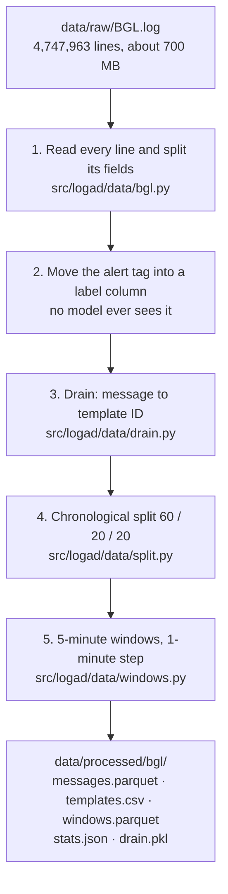

### 2.1 The dataset: BGL

BGL comes from Loghub (Zhu et al., 2023), the standard collection of log datasets. It covers
3 June 2005 to 4 January 2006: 4,747,963 messages, 348,460 of them alerts (7.3%), in 41 alert
categories. The most common category, `KERNDTLB` (152,734 messages), is the kernel's
`data TLB error interrupt` shown above.

Zenodo, Loghub's official host, was unreachable from our development machine. We therefore used a
copy from a public GitHub repository, and verified that it is Loghub's file: its SHA-256 checksum
matches the repository's record, it has exactly 4,747,963 lines and 348,460 alerts, and it contains
all 2,000 lines of Loghub's official `BGL_2k` sample.

### 2.2 Step 1: reading the lines, and why the label is removed first

`parse_bgl_line` in `bgl.py` splits each line into its ten fields. The alert tag goes into two
columns, `alert_tag` and `label` (1 for an alert, 0 for normal), and **every model only ever reads the
`content` column** (or templates built from it).

This prevents **label leakage**. If a model could see `KERNDTLB` at the start of a line, it would
"detect" every alert perfectly without learning anything about the message. A test
(`tests/test_bgl.py`) checks that no alert tag can appear in the text a model reads. The demo shows
the same thing live: paste a full line and it reports the tag it removed.

### 2.3 Step 2: Drain turns messages into templates

Many messages differ only in their numbers:

```text
generating core.2275
generating core.2276
generating core.5089
```

They were printed by the same line of source code, so they mean the same thing. **Drain**
(He et al., 2017) finds that shared shape, the **template**, and replaces the parts that vary with the
wildcard `<*>`:

| Raw message (content) | Template |
|---|---|
| `generating core.2275` | `generating core.<*>` |
| `63543 double-hummer alignment exceptions` | `<*> double-hummer alignment exceptions` |
| `instruction cache parity error corrected` | `instruction cache parity error corrected` (nothing varies) |
| `ciod: LOGIN chdir(/p/gb1/stella/RAPTOR/2183) failed: Input/output error` | `ciod: LOGIN <*> failed: <*> <*>` |

Each distinct template gets an integer **template ID**, which LogBERT calls a **log key**. It plays
the role of a word in a vocabulary.

How Drain decides, for each new message:

<!-- diagram: drain -->
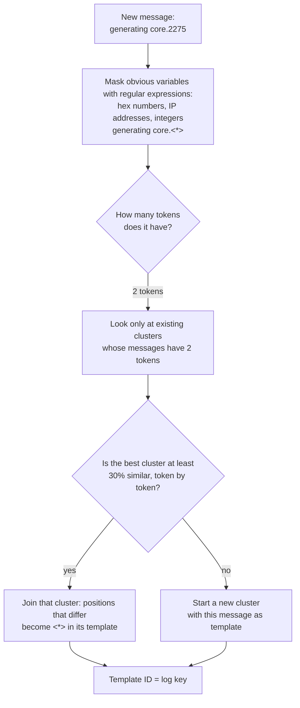

We use the `drain3` library with the LogBERT repository's settings for BGL: depth 3 (messages are
grouped by their number of tokens), similarity threshold 0.3, and its masking patterns. Clusters
whose final templates are identical share one ID. On full BGL, Drain forms 2,028 clusters with 923
distinct templates in 199 seconds. On Loghub's 2,000-line sample it finds 100 templates, against 120
in Loghub's hand-made ground truth, so it merges a little too much.

That over-merging matters later. `data <*> <*>` mixes storage-interrupt alerts with normal messages,
and `ciod: LOGIN <*> failed: <*> <*>` hides the very words (`Input/output error` versus
`Permission denied`) that decide whether the message is an alert (Section 5.4). Ten templates hold
both alert and normal messages; they contain 2.74% of all messages.

### 2.4 Step 3: the chronological split

We cut the **timeline** into three periods: the first 60% of the time for **training**, the next 20%
for **validation** (choosing settings), the last 20% for **testing** (the reported results). We never
shuffle. A random split would put messages from December into training and messages from June into
the test set, so the model would learn from the future. Le & Zhang (2022) showed that random splits
make semi-supervised detectors such as LogBERT look much better than they are in practice. A
chronological split copies real use: train on the past, judge the future.

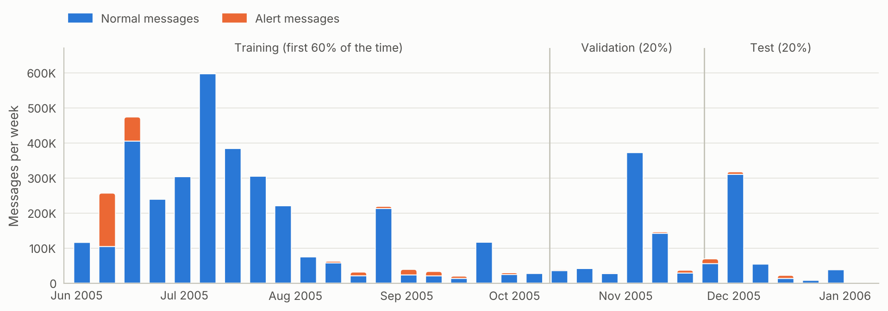

*Figure 1. Messages per week, split into normal (blue) and alert (orange) messages. Alerts come in
bursts (June 2005). The periods are cut by time, so they hold different numbers of messages.*

| Period | Dates (UTC) | Messages | Alerts | Windows | Anomalous windows | Templates (never seen in training) |
|---|---|---:|---:|---:|---:|---:|
| Training | 2005-06-03 to 2005-10-10 | 3,569,472 | 296,569 | 21,112 | 2,083 | 442 (0) |
| Validation | 2005-10-10 to 2005-11-22 | 696,160 | 22,976 | 10,478 | 446 | 375 (167) |
| Test | 2005-11-22 to 2006-01-04 | 482,331 | 28,915 | 5,742 | 495 | 472 (361) |

### 2.5 Step 4: sliding windows

LogBERT, and therefore our shared evaluation, judges the log in **5-minute windows that slide by 1
minute**. Each window holds every message printed in its 5 minutes, and a window is **anomalous if it
contains at least one alert**. Because the windows overlap, one message belongs to up to five
windows:

<!-- diagram: windows -->
```mermaid
gantt
    title Five-minute windows sliding by one minute
    dateFormat HH:mm
    axisFormat %H:%M
    section Windows
    Window 1 is anomalous  :w1, 10:00, 5m
    Window 2 is anomalous  :w2, 10:01, 5m
    Window 3 is anomalous  :w3, 10:02, 5m
    Window 4 is anomalous  :w4, 10:03, 5m
    Window 5 is anomalous  :w5, 10:04, 5m
    Window 6 is normal     :w6, 10:05, 5m
    section Messages
    One alert message      :crit, a1, 10:04, 1m
```

Windows are built separately inside each period, so no window mixes training and test messages.
Because the messages are sorted by time, a window is stored as just two numbers: the index of its
first message and the index after its last (`start_idx`, `end_idx`). Our implementation finds all
windows at once with binary search, and a test checks that it gives exactly the windows of the
original LogBERT code (`tests/test_windows.py`).

### 2.6 The log changes over time

The most important property of this dataset, for both approaches, is that **the test period is full
of messages that never appeared in training**:

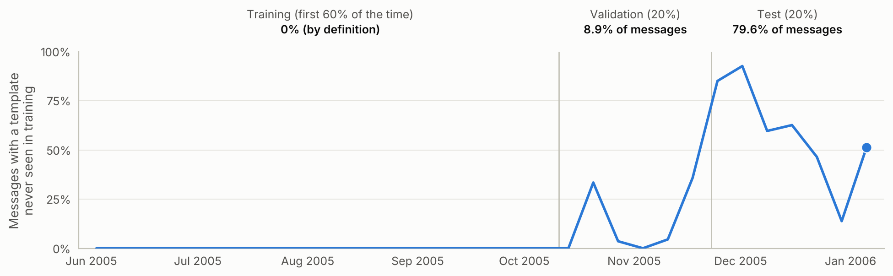

*Figure 2. The share of each week's messages whose template never occurs in the training period. It
is 0% during training by definition, 8.9% in validation and 79.6% in the test period.*

Two periodic diagnostics, `<*> total interrupts. …` and `<*> microseconds spent in the rbs signal
handler …`, appear in December with 135,092 test messages each, and never before October 2005. As a
result, **71.1% of the normal test windows contain at least one never-seen template**, against 9.6%
of the normal validation windows. Le & Zhang (2022) call this the "new log events" problem. Keep it
in mind: it explains most of LogBERT's behaviour in Part 3.

---

## Part 3 — Approach A: LogBERT

### 3.1 The idea in one paragraph

LogBERT learns what **normal** windows look like and flags windows it cannot predict. During
training it reads only windows without alerts. It hides some log keys and learns to guess them from
the keys around them, like a student filling in blanks in sentences from normal days. At test time
it hides keys again. If it fails to guess too many of them, the window does not look like any normal
window it knows, so it is called anomalous. LogBERT never reads a single word of the messages: only
the sequence of template IDs.

### 3.2 Background: from IDs to vectors (embeddings)

A neural network computes with numbers, so every log key is turned into a vector: a list of 256
numbers called its **embedding**. At the start of training the vectors are random; training adjusts
them so that keys that appear in similar contexts get similar vectors. In LogBERT the table of
embeddings is a 176 × 256 matrix: 172 real log keys plus four special tokens.

| Special token | Index | Purpose |
|---|---:|---|
| `<pad>` | 0 | fills up short sequences in a batch so all have the same length; ignored |
| `<unk>` | 1 | stands for any template the model did not see in normal training windows |
| `<dist>` | 2 | placed first in every sequence; its output summarises the whole sequence (like BERT's `[CLS]`) |
| `<mask>` | 3 | replaces a key the model must guess |

A window becomes a sequence such as `[<dist>, 17, 17, 52, 8, 17, …]`. Windows longer than 511 keys
are cut into several chunks, each with its own `<dist>`.

### 3.3 Background: the Transformer encoder and self-attention

A **Transformer encoder** turns the sequence of embeddings into a sequence of *contextual* vectors:
the output at each position describes that key *in the context of the whole window*. Its core is
**self-attention**: every position asks "which other positions matter for me?", gives each of them a
weight, and takes a weighted average of their vectors.

Each position produces three vectors from its embedding: a **query** (what I am looking for), a
**key** (what I contain) and a **value** (what I pass on). The weight between two positions is the
similarity of one's query with the other's key:

```math
\text{Attention}(Q, K, V) = \operatorname{softmax}\!\left(\frac{Q K^{\top}}{\sqrt{d}}\right) V
```

Here `Q`, `K` and `V` stack the queries, keys and values of all positions, `d` is their length, and
softmax turns the similarities into weights that sum to 1. **Multi-head** attention runs four such
attentions side by side (4 heads of 64 dimensions each), so different heads can follow different
patterns. Attention by itself ignores order, so a fixed **sinusoidal position encoding** (sine and
cosine waves of different frequencies, from *Attention Is All You Need*) is added to every
embedding. Each layer adds a small feed-forward network (256 → 1024 → 256 with the GELU activation),
**layer normalisation** and **residual connections**, which keep training stable.

Our LogBERT:

<!-- diagram: logbert-architecture -->
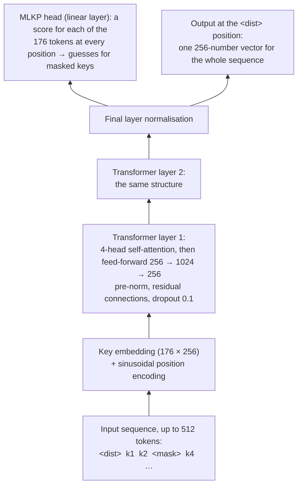

| Setting | Value | Why |
|---|---|---|
| Layers / heads / hidden size / feed-forward | 2 / 4 / 256 / 1024 | the LogBERT paper's description (its repository uses 4 layers) |
| Maximum length | 512 tokens (`<dist>` + 511 keys) | the repository's setting; longer windows are split into chunks |
| Parameters | 1,670,320 | small: BERT-base has 110 million |
| Vocabulary | 172 keys + 4 special tokens | every key that occurs in a normal training window |

### 3.4 BERT's training trick: fill in the blanks

**BERT** (Devlin et al., 2019) learns language by **masked language modelling**: hide a word and
predict it from both sides. Given *"the server ____ after the power failure"*, a model that
understands the context should guess *"restarted"*. No labels are needed; the text itself provides
the answers.

LogBERT applies the same idea to log keys and calls it **masked log key prediction (MLKP)**. In every
training sequence it selects 50% of the keys. As in BERT, 80% of the selected keys become `<mask>`,
10% become a random key and 10% stay unchanged (so the model cannot rely on seeing `<mask>`). The
loss is the cross-entropy of the true keys at the selected positions `M`:

```math
\mathcal{L}_{\text{MLKP}} = -\frac{1}{|M|} \sum_{i \in M} \log p_\theta\!\left(k_i \mid \text{masked sequence}\right)
```

In words: the model is rewarded for giving a high probability to the key that was really there.

### 3.5 The second objective: a hypersphere around "normal"

LogBERT adds a second loss, the **volume of hypersphere minimisation (VHM)**, borrowed from Deep SVDD
(Ruff et al., 2018). The `<dist>` output of every normal sequence is pulled towards one centre point
`c` (the average `<dist>` vector of the training sequences, recomputed at the start of each epoch).
Normal sequences should end up in a small ball around `c`:

```math
\mathcal{L} = \mathcal{L}_{\text{MLKP}} + 0.1 \cdot \frac{1}{N} \sum_{j=1}^{N} \left\lVert h_j^{\langle \text{dist} \rangle} - c \right\rVert^2
```

The weight 0.1 is the repository's. As in the paper's detection rule, only the masked-key part is
used at detection time; the hypersphere shapes what the model learns.

### 3.6 Training on normal windows only

LogBERT is **semi-supervised** (also called one-class learning): it never sees an alert. It only
needs to know which windows are normal, which is cheap to obtain in practice.

<!-- diagram: logbert-training -->
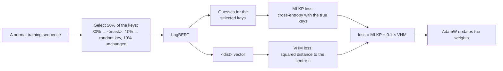

What happened in the reported run:

- The training period has 21,112 windows; the 19,029 without an alert are normal. Windows with fewer
  than 10 keys are skipped, as in LogBERT, which leaves 35,035 normal chunks.
- Those chunks hold only 12,394 *distinct* sequences: periodic messages repeat the same pattern again
  and again. On the CPU we kept one copy of each (`dedupe_sequences`), giving 11,615 training and 820
  dev sequences.
- The **dev set** is the chronologically last 10% of the normal training windows. Training stops
  when the dev loss stops improving (early stopping), so the labelled validation period stays
  untouched for choosing g and r.
- Settings: AdamW optimiser, learning rate 0.001 with 200 warm-up steps, batch size 64, at most 6
  epochs (patience 3), the centre `c` estimated from 4,000 sequences, gradients clipped at 1.0, and
  batches grouped by length so little padding is wasted. Training took 60 minutes on 4 CPU cores.

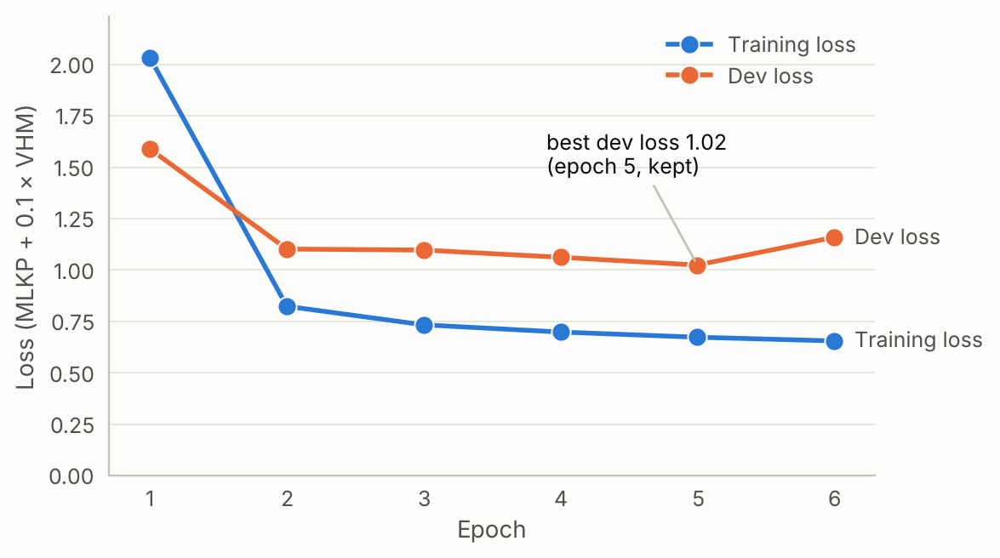

*Figure 3. The loss falls quickly in the first epoch. The dev loss is lowest at epoch 5 (1.02), and
that model is kept. The dev loss stays above the training loss, probably because the dev windows come
later in time and differ slightly from the training windows.*

### 3.7 Detection: how LogBERT decides that a window is anomalous

<!-- diagram: logbert-detection -->
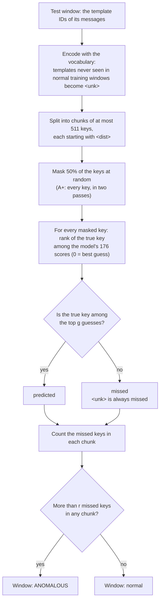

A small worked example with g = 12 and r = 3: a chunk has 40 keys and 20 are masked. For 17 of them
the true key is among the model's top 12 guesses; 2 are ranked lower; 1 is `<unk>`. That makes
3 missed keys, which is not more than r = 3, so the chunk is normal. One more miss would flag the
whole window.

Two details of our implementation:

- **Unseen keys are always misses.** The model cannot predict a key it never learned, so `<unk>`
  gets the worst possible rank. This rule is central to what follows.
- **One forward pass for all settings.** We store the rank of every masked key. Then "missed at g"
  is just `rank >= g`, and all 231 (g, r) pairs can be evaluated without running the model again.

### 3.8 Choosing g and r on the validation period

g and r are LogBERT's two knobs: a larger g forgives more uncertain guesses, a larger r tolerates
more misses. We try g ∈ {1, 2, 3, 4, 5, 6, 8, 10, 12, 15, 20} and r ∈ {0, …, 20} on the
**validation** windows and keep the pair with the best F1, then apply it once to the test windows.

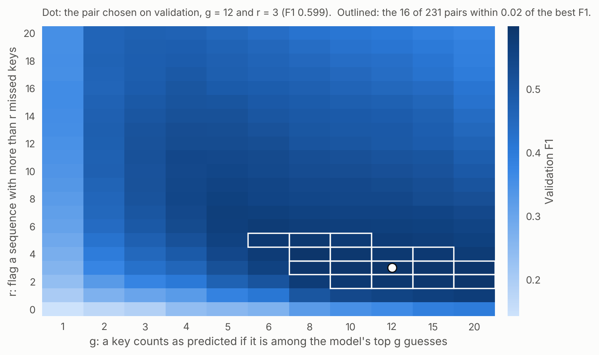

*Figure 4. Validation F1 for each pair. The best is g = 12, r = 3 (F1 0.599). Only 16 of the 231
pairs come within 0.02 of it, so the choice matters.*

The original LogBERT code picks its threshold on the **test** results. Doing that here would raise
the test F1 from 0.293 to at least 0.475 (g = 6, r = 20), which would be an inflated, dishonest
number. Tuning on validation is the fair way.

### 3.9 Our extension: full-coverage masking (A+)

With random 50% masking, any single message is checked only about half the time: if the one alert
in a window is not masked, LogBERT never looks at it. Our **full-coverage** mode splits the positions
into two disjoint halves and masks each half in turn, so **every key is checked exactly once**, at
twice the cost. It is reported as a separate method, A+ (`logbert_full`, g = 8, r = 8): F1 rises from
0.293 to 0.305 and the false positives fall from 2,159 to 1,975.

### 3.10 What happens inside the trained model

To see what LogBERT relies on, `make_figures.py` ran the trained model once more over the whole test
period, masking every key once, and recorded how often it misses the true key:

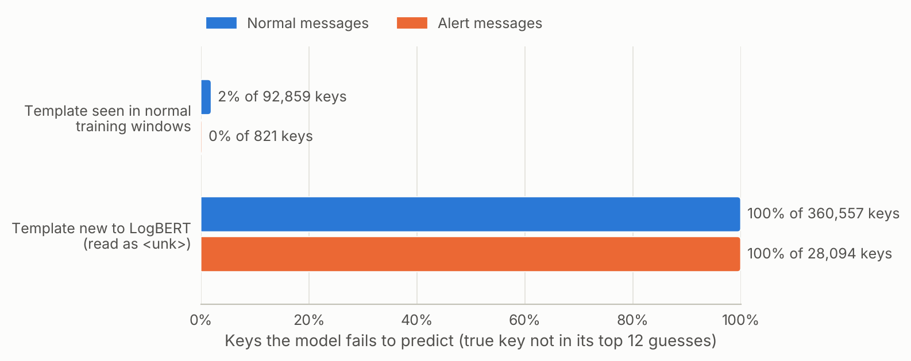

*Figure 5. For templates LogBERT knows, it misses only 2% of normal keys (and 0.24% of the 821 alert
keys whose templates also occur in normal windows). Templates new to the model are missed 100% of the
time, by construction.*

The key fact hides in the counts: **28,094 of the 28,915 alert keys (97%) belong to templates LogBERT
never saw**, because alert templates rarely occur in normal training windows. So LogBERT flags alerts
mostly *because they are new*, not because it understands them. But 360,557 normal keys in the test
period are new as well (Section 2.6), and they are missed in exactly the same way. Looking at whole
windows confirms it:

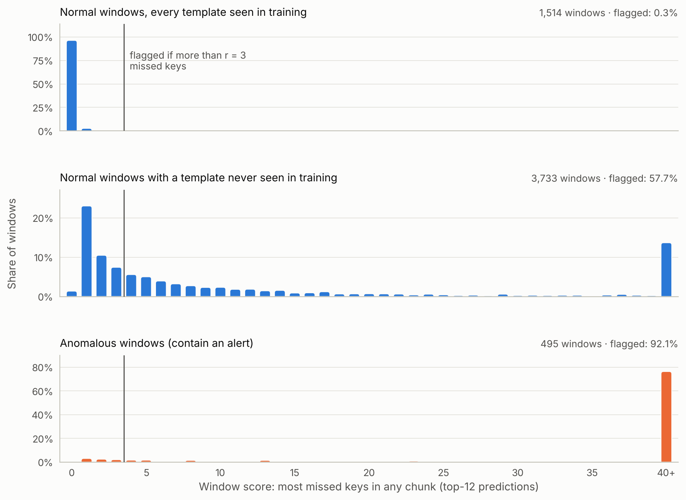

*Figure 6. The window score is the largest number of missed keys in any chunk; the vertical line is
the threshold r = 3. Normal windows whose templates were all seen in training are almost never
flagged (0.3%). Normal windows containing a never-seen template are flagged 57.7% of the time, and
anomalous windows 92.1% of the time.*

That is LogBERT's result in a nutshell: **high recall, low precision**, and 99.8% of its 2,159 false
positives contain a template never seen in training.

### 3.11 How our LogBERT differs from the original code

We checked each point against the source of the LogBERT repository (`HelenGuohx/logbert`):

| Aspect | LogBERT repository | This project | Why |
|---|---|---|---|
| Train/test selection | normal windows shuffled; 40% train, rest test | chronological 60/20/20 | Le & Zhang (2022); realistic deployment |
| Threshold selection | searched on the test results | g and r tuned on validation | avoids tuning on test |
| Short test windows | skipped below `min_len` | every window evaluated | both approaches must score the same windows |
| Long windows | truncated to the first 512 keys | split into chunks | later messages would go unchecked |
| Decision rule | misses > a share of masked keys | misses > r | the paper's formulation |
| Encoder depth | 4 layers | 2 layers | the paper's description |
| Training budget | batch 32, up to 200 epochs, patience 10 | batch 64, up to 50 epochs (6 on CPU), patience 5 (3 on CPU) | compute |
| Hypersphere centre | mean over train and validation data | mean over training sequences only | keeps the validation period untouched |

---

## Part 4 — Approach B: the rule-guided LLM

### 4.1 The idea in one paragraph

Approach B reads the **words**. A large language model first studies labelled training templates
and writes **rules** such as "messages mentioning 'kernel panic' are abnormal", each with keyword
phrases. Only rules that are never wrong on the training data are kept. To label a new template, the
LLM is given the rules and asked to apply them. As a control, the same rules are also applied by
plain keyword matching, without any LLM. Each unique template is labelled once, and its label is
copied to every message with that template.

### 4.2 Background: what a large language model is

A **large language model (LLM)** is a Transformer trained to predict the next token (a word or a
piece of a word) on a huge amount of text. Unlike LogBERT's encoder, it is a *decoder*: it reads the
text so far and generates the continuation one token at a time. After this pre-training, **instruction
tuning** teaches it to follow requests in a chat format: a *system* message sets the role, a *user*
message asks, and the model writes the *assistant* reply.

We use **Qwen2.5-7B-Instruct**, an open instruction-tuned model with 7.6 billion parameters from
Alibaba's Qwen team. LogRules also used it to apply its rules. The model is used as it is: nothing is
trained in Approach B.

How we ran it without a GPU or an API key:

- **Quantisation.** The weights are stored with about 4 bits each instead of 16 (the official
  `q4_k_m` GGUF build). The model shrinks to 4.7 GB and fits in a laptop's memory, at a small cost in
  quality.
- **llama.cpp.** A fast C++ engine runs the model on the CPU. Its `llama-cpp-python` server speaks the
  same "chat completions" web API as OpenAI, Ollama and vLLM, so our client works with any of them.
- **Greedy decoding.** Temperature 0 means the model always picks its most likely next token, so the
  same prompt always gives the same answer and the run is reproducible.
- **Speed.** On 4 CPU cores the model reads about 23 tokens per second and writes about 5, so one
  template takes 6 to 7 seconds. Every prompt ends with the log line, so all the text before it is
  identical across templates. The server then reuses its work on that shared beginning (prefix
  caching), which makes each call about 20% faster.

One classification request, end to end:

<!-- diagram: llm-call -->
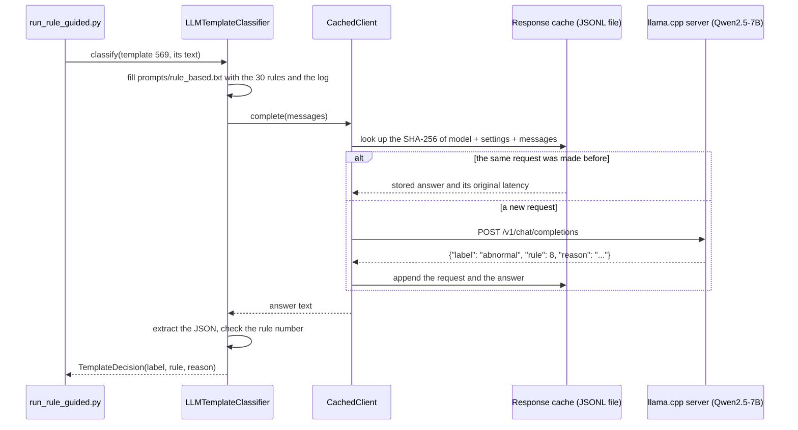

The **response cache** stores every prompt and answer. A rerun costs nothing, an interrupted run
resumes where it stopped, and the file is a complete, auditable record of the experiment. It is
committed in `results/llm_cache/` (1,458 calls).

### 4.3 Background: prompting without training

An instruction-tuned LLM can do a new task from a description alone. What we put in the prompt is
the only thing that changes between Approach B's conditions:

- **Zero-shot:** only the task description and the log. The model relies on its general knowledge.
- **Few-shot:** the prompt also contains labelled examples. The model picks up the pattern from them
  without any training; this is called **in-context learning** (Brown et al., 2020). LogRules calls
  it *case-based* prompting.
- **Rule-based:** the prompt contains explicit rules instead of examples.

The complete zero-shot prompt (`prompts/zero_shot.txt`; `$log` is replaced by the template):

```text
### SYSTEM
You are an expert in operating large-scale supercomputers and in analysing their system logs.
### USER
Below is a log message template from the BlueGene/L supercomputer. Variable parts of the message
(numbers, addresses, file names) have been replaced by <*>.

Does this log message indicate an anomaly (a failure, error or abnormal condition that operators
should be alerted about) or normal operation?

Answer with a single JSON object and nothing else, in this format:
{"label": "abnormal" or "normal", "reason": "<one short sentence>"}

Log: $log
```

The few-shot prompt adds eight fixed training templates, four of each label, chosen at random with a
fixed seed. In the reported run they were:

| Label | Example template |
|---|---|
| normal | `memory manager <*> <*>` |
| normal | `<*>:<*>c<*> <*>:<*> <*> <*>` |
| abnormal | `mmcs_server exited abnormally due to signal: Segmentation fault` |
| normal | `DeclareServiceNetworkCharacteristics has been run with the force option but the DB is not empty` |
| abnormal | `data <*> <*>` |
| normal | `<*>:<*> <*> <*>:<*>eeeeeee <*>` |
| abnormal | `Error: unable to mount filesystem` |
| abnormal | `rts: kernel terminated for reason <*>rts: bad message header: too many packets, …` |

The rule-based prompt lists the 30 rules, numbered in rank order, and asks the model to "find the
first rule that applies" and to cite its number, or 0 if none applies. It asks for
`{"label": …, "rule": <number>, "reason": …}`.

### 4.4 LogRules in three stages, and which we implement

<!-- diagram: logrules -->
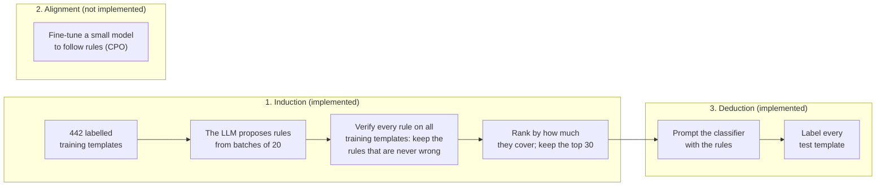

LogRules' alignment stage fine-tunes a small model to follow rules better. It needs GPUs and
preference data, so it is out of scope, and our classifier uses the rules exactly as written.

### 4.5 Rule induction

1. **The training pool.** Every template that occurs in the training period, labelled by the majority
   of its training messages: 442 templates, 31 abnormal and 411 normal.
2. **Batches.** The generator LLM sees 20 templates at a time, 10 of each label. There are few
   abnormal templates, so they are reused across batches to keep the batches balanced. One pass over
   the pool is 42 batches (the reported run made one pass; the default configuration makes three).
3. **The prompt** (`prompts/rule_induction.txt`) shows the labelled templates and asks for "general
   rules that explain these labels". Each rule must list keyword phrases "copied exactly from the logs
   above" that never appear in a log of the opposite label, with at most 8 rules per batch, answered
   as JSON.
4. **Parsing.** Each proposal becomes a `Rule`: a sentence, its keywords (lower-cased, spaces
   normalised) and a label. Keywords with fewer than three letters or digits are dropped because they
   would match almost anything. Proposals with the same label and keywords are merged.

The beginning of a real answer from the first batch:

```json
{"rules": [
  {"rule": "Indicates a kernel or system termination event.",
   "keywords": ["kernel terminated for reason", "rts: bad message header"], "label": "abnormal"},
  {"rule": "Signals an error in the file system mounting process.",
   "keywords": ["Error: unable to mount filesystem", "Lustre mount FAILED"], "label": "abnormal"},
  ...
```

The 42 batches produced **160 distinct candidate rules** in 50 minutes.

### 4.6 Verification and ranking

An LLM can write rules that sound right but are wrong, so every candidate is **verified** on the
whole training pool. A rule *fires* on a template if any of its keywords occurs in the template text
(case-insensitive). For each rule we count the templates it fires on and how many of them have the
rule's label.

- **Keep** a rule only if it fires on at least one template and is **never wrong** (precision 1.0).
  99 of the 160 candidates pass: 80 abnormal and 19 normal.
- **Rank** the kept rules by usage: training templates covered correctly, then messages covered, then
  how often the LLM proposed the rule.
- **Use the top 30** (LogRules' setting): 22 abnormal and 8 normal rules.

The first ten (all 99 are in `results/rules/rules.md`):

| # | Label | Rule, as the LLM wrote it | Keywords (abbreviated) | Training templates |
|---:|---|---|---|---:|
| 1 | normal | Describes normal system operations or status updates. | `<*>:<*>eeeeeee`, `program interrupt`, `input interrupt enable`, … | 37 |
| 2 | normal | Log messages related to normal operations or status updates. | `pro`, `total of <*> ddr error(s) detected and corrected`, … | 35 |
| 3 | abnormal | Indicates a system error or failure. | `machine check interrupt`, `mmcs_server exited abnormally`, `lustre mount failed`, `kernel panic`, … | 14 |
| 4 | abnormal | Messages mentioning 'FAILED', 'terminated for reason', 'kernel panic', and 'machine check interrupt' are indicative of system failures. | `lustre mount failed`, `rts: kernel terminated for reason`, `kernel panic`, `machine check interrupt` | 9 |
| 5 | normal | Indicates a normal operation or system state. | `machine state register`, `byte ordering exception`, … | 9 |
| 6 | abnormal | Points out a critical system failure that requires immediate attention. | `kernel terminated for reason`, `no ethernet link`, … | 8 |
| 7 | abnormal | Signals an execution stop due to panic or kernel issues. | `rts panic!`, `ciod: error reading message prefix`, … | 8 |
| 8 | abnormal | Indicates a system or process has stopped unexpectedly. | `terminated`, `panic! - stopping execution`, `exited abnormally` | 7 |
| 9 | abnormal | Log messages containing 'terminated', 'panic!', or 'exited abnormally' indicate critical system failures. | `terminated`, `panic!`, `exited abnormally` | 7 |
| 10 | abnormal | Messages containing 'terminated', 'panic!', 'stopping execution', or 'exited abnormally' are likely abnormal. | `terminated`, `panic!`, `stopping execution`, `exited abnormally` | 7 |

Three weaknesses are visible already. The sentences are often vague ("Indicates a system error or
failure."). Several rules are near-duplicates (8, 9 and 10). And some keywords, such as `pro` or
`<*>:<*>eeeeeee`, pass verification only because no training template happens to contradict them.
Most importantly, **verification checks the keywords, not the sentence** the LLM will read.

### 4.7 Deduction: the four conditions

| Condition | What the classifier gets | Who decides |
|---|---|---|
| **B1 zero-shot** | the template only | Qwen2.5-7B |
| **B2 few-shot** | + the 8 labelled training examples | Qwen2.5-7B |
| **B3 rule-based** | + the 30 ranked rules | Qwen2.5-7B |
| **B4 keyword rules** | the same 30 rules, as a decision list: the first rule whose keyword occurs decides; if none fires, the template is normal | plain string matching, no LLM |

B4 is the control experiment: if B3 is no better than B4, the rules do the work, not the LLM.

From template labels to window verdicts:

<!-- diagram: template-to-window -->
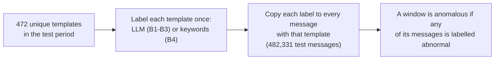

Classifying 472 templates instead of 482,331 messages makes the LLM affordable. The price is that
messages sharing a template must share a label; Section 5.4 measures how little that costs here.

The answers are parsed as JSON, with a fallback that looks for the words "abnormal" or "normal". An
unusable answer would count as "normal" and be reported; in the run all 1,416 answers were usable.
Some real answers:

| Template | Truth in test | B1 zero-shot | B2 few-shot | B3 rule-based |
|---|---|---|---|---|
| `<*> TLB error interrupt` | alert (12 messages) | abnormal: "TLB error interrupt indicates a hardware issue" | abnormal | abnormal, cites rule 24 |
| `instruction cache parity error corrected` | normal (33,547 messages) | **abnormal**: "instruction cache parity error indicates a hardware issue" | normal | normal, rule 0 |
| `ciod: Received signal <*>, code=<*>, errno=<*>, address=<*>` | normal (27,510 messages) | **abnormal** | **abnormal** | **abnormal**, cites rule 8: "contains 'terminated'" |
| `ciod: LOGIN <*> failed: <*> <*>` | alert (816 messages) | abnormal: "LOGIN failure indicates an error" | **normal** | **normal**, rule 0 |

Bold marks wrong answers. Note the third row: the template does not contain "terminated" at all.

### 4.8 What the guidance does to the LLM

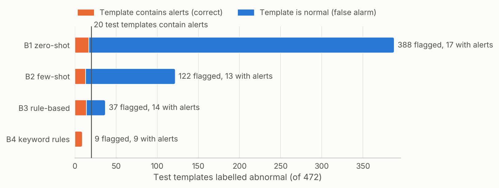

*Figure 8. Of the 472 test templates, 20 contain alerts. Zero-shot, Qwen flags 388 templates; with
8 examples, 122; with the 30 rules, 37; the keyword rules flag 9, all correct.*

On its own, the LLM calls almost anything that sounds like an error abnormal. Its idea of "abnormal"
is not the administrators' idea of an alert. Examples narrow it, and rules narrow it much further.
This matches LogRules' claim that rules help more than examples. Yet the plain keyword matcher, which
uses the same rules, is cleaner than any LLM condition.

### 4.9 Does the LLM really apply the rules?

`scripts/analyze.py` checks every rule the rule-based LLM cites against the template it labelled
(`results/analysis/rule_faithfulness.json`):

- B3 cites a rule in 420 of its 472 answers. In 349 of them it cites rule 1, the vague "normal
  operations" rule, as a catch-all for normal answers.
- **The cited rule's keywords occur in the template in only 20 of the 420 citations.** Only 12
  citations name the rule the keyword decision list would actually apply.
- The LLM never labels normal a template the keyword rules call abnormal. It adds 28 abnormal labels
  of its own. Five of them are real alert templates that no keyword matches, such as
  `MidplaneSwitchController::receiveTrain() iap failed …` and `Power Good signal deactivated …`,
  worth 14 more anomalous windows. The other 23 are false alarms covering 57,309 normal messages.
- All 23 false alarms cite an abnormal rule whose keywords do not occur in the template, and 12 cite
  rule 4. Its sentence talks about "Messages mentioning 'FAILED' …", but its verified keywords are
  `lustre mount failed`, `rts: kernel terminated for reason`, `kernel panic` and
  `machine check interrupt`. The model applies the broad sentence to
  `ciod: Error loading … Permission denied` (13,952 messages) and to
  `ciod: LOGIN <*> failed: No such file or directory` (3,623 messages).

The conclusion: **the LLM follows the rules' sentences, not their keywords**, and only the keywords
were verified.

### 4.10 The keyword rules, and how many rules to keep

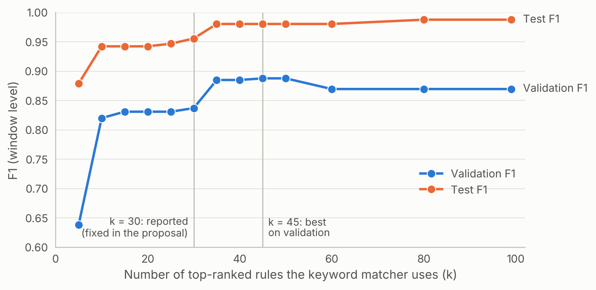

*Figure 9. The keyword matcher's F1 when it uses the top k rules. k = 30 is the reported setting;
validation would have picked k = 45.*

Ranking by raw usage fills the top 30 with near-duplicates: 12 of them are variants of "terminated",
"panic" or "exited abnormally". That pushes the rule for `socket closed` to rank 32 and the rules for
`receiveTrain() iap failed` to ranks 63 and 64, and those two templates account for most of the
keyword rules' missed windows. With k = 45, chosen on validation, the test F1 would be 0.980 instead of
0.956. We report k = 30 because the proposal fixed it in advance. Choosing rules for the *new*
templates they cover, instead of raw usage, would avoid the problem.

---

## Part 5 — Evaluation and results

### 5.1 The metrics

Every method gives a verdict on every test window. Comparing verdicts with the truth gives four
counts, the **confusion matrix**:

| | Window really anomalous | Window really normal |
|---|---|---|
| **Flagged as anomalous** | true positive (TP): a caught failure | false positive (FP): a false alarm |
| **Not flagged** | false negative (FN): a missed failure | true negative (TN) |

From them:

```math
\text{Precision} = \frac{TP}{TP + FP} \qquad \text{Recall} = \frac{TP}{TP + FN} \qquad F_1 = \frac{2 \cdot \text{Precision} \cdot \text{Recall}}{\text{Precision} + \text{Recall}}
```

- **Precision**: of the windows we flagged, how many were really anomalous? Low precision means the
  operators drown in false alarms.
- **Recall**: of the anomalous windows, how many did we flag? Low recall means missed failures.
- **F1**: the harmonic mean of the two, high only when both are high. It is our main score.
- **False positives** (FP) are also reported as a count, because each one is a false alarm someone
  has to check.

Worked example, LogBERT on the test windows: TP = 456, FP = 2,159, FN = 39, TN = 3,088. Precision =
456 / (456 + 2,159) = 0.174, recall = 456 / (456 + 39) = 0.921, F1 = 2 × 0.174 × 0.921 / (0.174 +
0.921) = 0.293. Its accuracy would be (456 + 3,088) / 5,742 = 62%, which hides how bad the false-alarm
rate is, and a detector that never flags anything would score 91% accuracy. That is why accuracy is
not used.

Two more measurements:

- **Message-level F1** (Approach B only): the same metrics computed per message instead of per window,
  the unit the LogRules paper uses.
- **Inference time**: for LogBERT, the time to score the 5,742 test windows; for Approach B, the summed
  time of classifying the 472 test templates. All on the same 4 CPU cores.

### 5.2 A fair comparison

<!-- diagram: evaluation -->
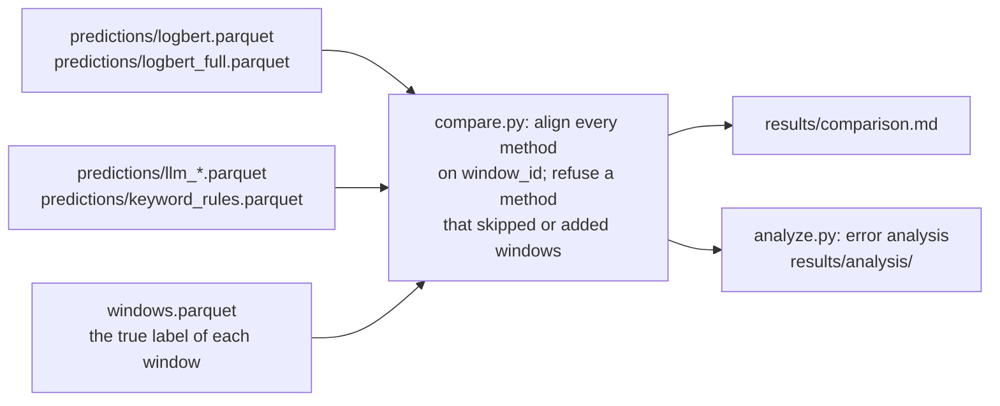

The rules that make the comparison fair:

1. **Same data, same split.** Both approaches learn only from the training period.
2. **Same test windows.** Every method must give a verdict on exactly the 5,742 test windows;
   `compare.py` recomputes every metric from the saved predictions and refuses a method that does not.
3. **No tuning on test.** LogBERT's g and r are chosen on validation. The 30 rules and the prompts
   are fixed before the test period is looked at.
4. **No label leakage.** The alert tag is removed before any model reads a message.

### 5.3 The results

| Method | Precision | Recall | F1 | False positives | Message-level F1 | Inference |
|---|---:|---:|---:|---:|---:|---:|
| A: LogBERT (g = 12, r = 3) | 0.174 | 0.921 | 0.293 | 2,159 | – | 78 s |
| A+: LogBERT, full coverage (g = 8, r = 8) | 0.184 | 0.897 | 0.305 | 1,975 | – | 156 s |
| B1: LLM zero-shot | 0.108 | 1.000 | 0.194 | 4,103 | 0.180 | 47 min |
| B2: LLM few-shot | 0.323 | 0.941 | 0.481 | 976 | 0.444 | 53 min |
| B3: LLM rule-based | 0.489 | 0.943 | 0.644 | 488 | 0.491 | 57 min |
| B4: keyword rules, no LLM | 1.000 | 0.915 | **0.956** | 0 | 0.984 | 8 ms |
| Template-level oracle (upper bound for B) | 1.000 | 0.992 | 0.996 | 0 | 0.999 | – |

The test period has 5,742 windows, 495 (8.6%) of them anomalous. The oracle labels each template by
its true majority in the test period; no method that labels whole templates can do better.

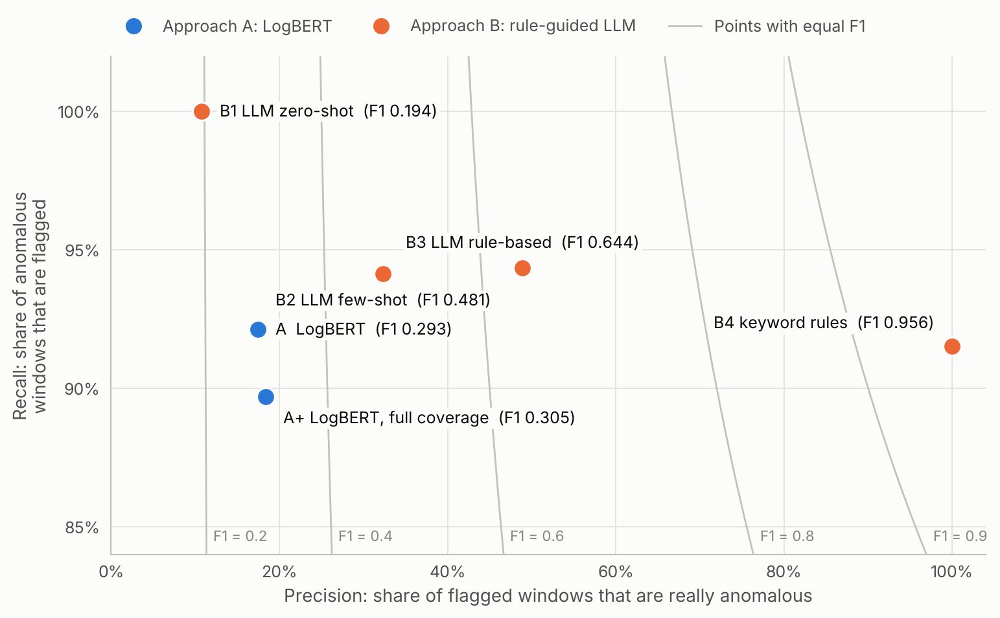

*Figure 7. Each dot is a method. Every method finds about 90% or more of the anomalous windows; what
separates them is precision, the share of their alarms that are real. The grey curves join points
with equal F1.*

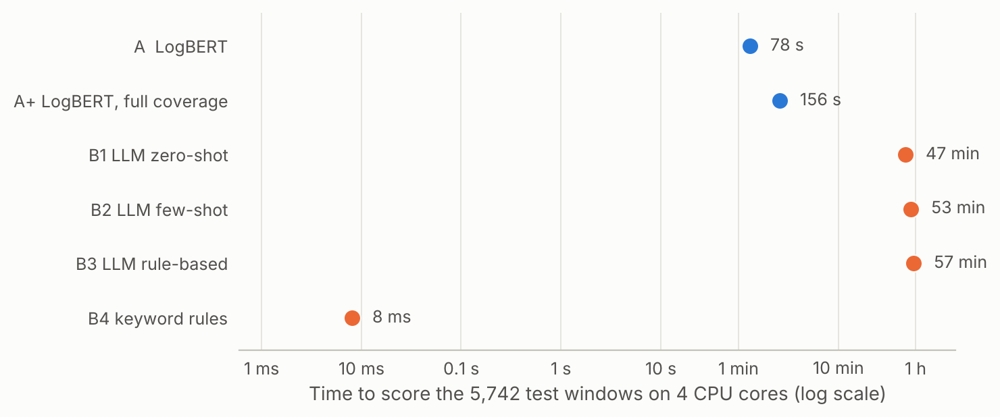

*Figure 10. Time to give a verdict on the whole test period. The keyword rules take 8 milliseconds;
the LLM conditions take about an hour each (6 to 7 seconds per template). One-off costs come on top:
60 minutes to train LogBERT and 50 minutes to induce the rules.*

### 5.4 Error analysis

**What each approach misses.** Window recall per alert category (`results/analysis/analysis.md`):

| Alert category (test windows) | A | A+ | B1 | B2 | B3 | B4 |
|---|---:|---:|---:|---:|---:|---:|
| `APPSEV` (341) | 0.977 | 0.953 | 1.000 | 1.000 | 1.000 | 1.000 |
| `KERNRTSP` (154) | 0.994 | 0.994 | 1.000 | 1.000 | 1.000 | 1.000 |
| `KERNMC` (141) | 0.979 | 0.986 | 1.000 | 1.000 | 1.000 | 0.979 |
| `MASABNORM` (61) | 0.984 | 0.984 | 1.000 | 1.000 | 1.000 | 1.000 |
| `KERNSOCK` (23): `<*> <*> <*> socket closed` | 0.391 | 0.217 | 1.000 | 0.174 | 0.087 | 0.000 |
| `LINKIAP` (7): `… receiveTrain() iap failed …` | 0.143 | 0.000 | 1.000 | 0.000 | 1.000 | 0.000 |

The large categories are caught by almost every method. The hard cases are short, generic messages
such as `socket closed`, whose rule sits just outside the top 30.

**Do the approaches complement each other?** On the 495 anomalous windows:

| Pair | Caught by both | Only A | Only B | Neither | F1 if either flags (OR) | F1 if both must flag (AND) |
|---|---:|---:|---:|---:|---:|---:|
| LogBERT and keyword rules (B4) | 438 | 18 | 15 | 24 | 0.301 | 0.939 |
| LogBERT and rule-based LLM (B3) | 446 | 10 | 21 | 18 | 0.280 | 0.776 |

They do miss different windows: LogBERT catches 18 that the keyword rules miss (half of them contain
`socket closed`), and the rules catch 15 that LogBERT misses. But combining them does not pay. OR keeps
all of LogBERT's false alarms, and AND scores 0.939, below the keyword rules alone (0.956). The one gain
is the rule-based LLM: requiring LogBERT to agree removes 280 of its 488 false alarms (F1 0.644 →
0.776), because the two raise false alarms for different reasons.

**Template purity.** If one template holds both alert and normal messages, any template-level method
must get some of them wrong. In the test period only 3 of the 472 templates are mixed, holding 258
messages and 31 of the 28,915 alerts. That is why the oracle reaches F1 0.996: labelling whole
templates costs almost nothing here.

**Labels that change between periods.** The purity check looks inside one period. Across periods,
two templates change their majority label. The most important is `ciod: LOGIN <*> failed: <*> <*>`:
in training it holds 472 normal messages (`chdir(…) failed: Permission denied`); in the test period,
816 alerts (`chdir(…) failed: Input/output error`). Drain replaced exactly the words that decide the
label with `<*>`, so the template looks normal to anything that learned from training. It accounts
for 816 of the 913 alert messages the keyword rules miss. It causes only 2 missed windows, though,
because most windows with these messages also contain other alerts that are caught.

### 5.5 Conclusion

**Answer to the research question.** Under one fair, chronological setup on BGL, the rule-guided
approach clearly beats the LogBERT reproduction: F1 0.644 for the rule-based LLM and 0.956 for the
same rules as keyword matching, against 0.293 for LogBERT.

1. **Why LogBERT loses: the log changes.** LogBERT sees only template IDs, and anything new looks
   anomalous to it. In the test period 79.6% of the messages have templates never seen in training,
   so it raises a false alarm in 57.7% of the normal windows that contain one.
2. **Why Approach B wins: it reads the words.** It can tell a new harmless message from an alert,
   and it labels a template normal unless there is a reason not to.
3. **But the verified rules do the work, not the LLM.** On its own the LLM flags most templates.
   With rules it improves a lot, but it applies them loosely, and plain keyword matching with the
   same rules is better, and about 400,000 times faster.
4. **The two approaches miss different alerts**, but LogBERT's false alarms make it a poor partner
   for the keyword rules.

**Limits.** These findings come from one dataset, one chronological split and one run of each
method under a CPU budget: LogBERT trained for at most 6 epochs, induction made one pass, and one
4-bit 7B model both wrote and applied the rules. A stronger rule generator, rules whose sentences are
checked as well as their keywords, a rule selection that rewards coverage, or a dataset whose
anomalies are less tied to particular words could change the balance.

---

## Part 6 — The code, file by file

### 6.1 How the repository is organised

<!-- diagram: repo-map -->
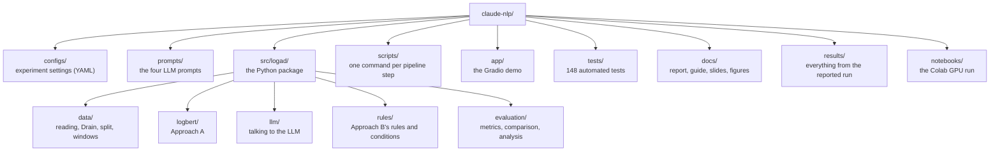

The design rule is simple: **`src/logad/` holds all the logic and `scripts/` holds thin command-line
entry points**, one per pipeline step. Every script reads the same YAML configuration, so one file
describes the whole experiment.

### 6.2 How one full run moves through the code

<!-- diagram: run-flow -->
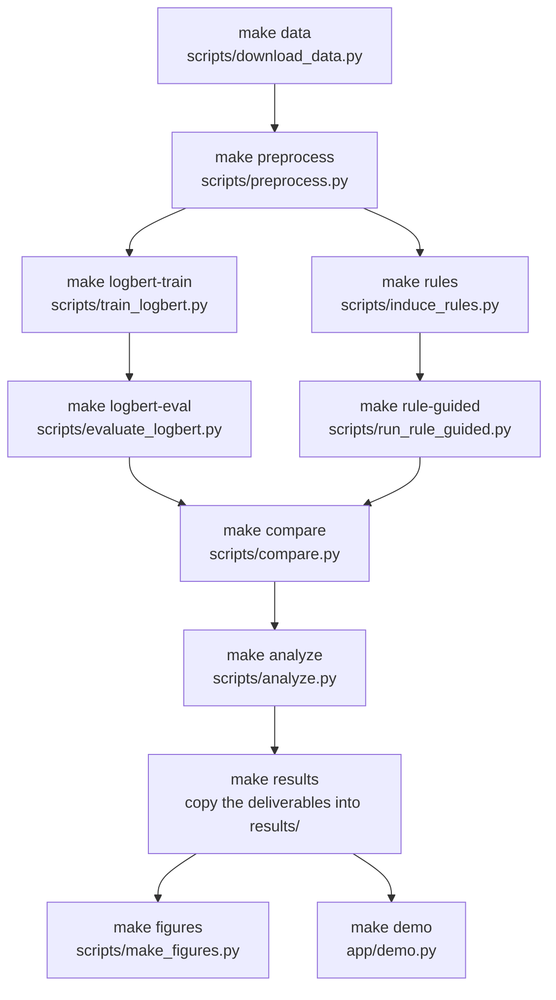

What each step reads and writes (`outputs/<run>/` is the run directory named in the configuration,
for example `outputs/bgl_cpu/`):

| Step | Reads | Writes |
|---|---|---|
| `download_data.py` | Loghub | `data/raw/BGL.log` |
| `preprocess.py` | `data/raw/BGL.log` | `data/processed/bgl/`: `messages.parquet`, `templates.csv`, `windows.parquet`, `stats.json`, `drain.pkl` |
| `train_logbert.py` | processed data | `outputs/<run>/logbert/model.pt`, `history.json` |
| `evaluate_logbert.py` | model, processed data | `predictions/logbert.parquet`, `results/logbert.json`, `logbert/logbert_tuning_grid.csv` (with `full_coverage=true`: the same files for `logbert_full`) |
| `induce_rules.py` | processed data, the generator LLM | `rules/candidates.json`, `rules/rules.json`, `rules/rules.md`, `rules/induction_summary.json` |
| `run_rule_guided.py` | rules, processed data, the classifier LLM | for each condition: `predictions/<method>.parquet`, `results/<method>.json`, `rule_guided/<method>_decisions.csv` |
| `compare.py` | every `predictions/*.parquet` | `results/comparison.md` and `.csv` |
| `analyze.py` | predictions, decisions, rules | `analysis/analysis.md` and one CSV per table |
| `make_figures.py` | processed data, the run directory, the model | `docs/figures/*.png`, `figure_data.json` |

### 6.3 How the packages depend on each other

Arrows mean "imports from". Every package also uses `config.py` and `utils.py` (left out to keep the
picture readable).

<!-- diagram: packages -->
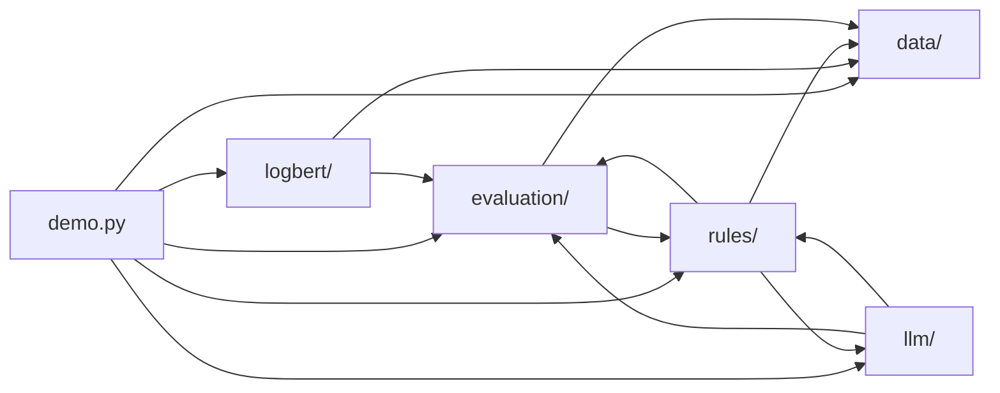

### 6.4 The main classes

<!-- diagram: classes -->
```mermaid
classDiagram
    class ExperimentConfig {
        paths, parsing, split, windows
        logbert, llm, rules, deduction
    }
    class ProcessedLogs {
        messages, templates, windows, stats
        template_ids()
        message_labels()
        template_text()
        windows_in(split)
    }
    class LogKeyVocab {
        keys
        encode(template_ids)
        decode(indices)
    }
    class LogBERT {
        token_embedding
        encoder
        mlkp_head
        forward(input_ids) LogBERTOutput
    }
    class LogBERTTrainer {
        compute_center()
        train_epoch()
        evaluate()
        fit(data, checkpoint_path)
    }
    class LogBERTDetector {
        predict_sequences(sequences)
        score_windows(template_ids, windows) WindowScores
    }
    class WindowScores {
        ranks
        predict(g, r)
        max_misses(g)
    }
    class Rule {
        text, keywords, label
        support, correct, message_coverage
        matches(text) bool
        describe() str
    }
    class KeywordClassifier {
        rules
        classify(template_id, text) TemplateDecision
    }
    class LLMTemplateClassifier {
        mode
        classify(template_id, text) TemplateDecision
    }
    class CachedClient {
        complete(messages) LLMResponse
    }
    class TemplateDecision {
        template_id, label, rule, reason
        parsed, latency_seconds, cached
    }
    class BinaryMetrics {
        tp, fp, tn, fn
        precision, recall, f1
    }
    LogBERTTrainer --> LogBERT : trains
    LogBERTDetector --> LogBERT : runs
    LogBERTDetector --> LogKeyVocab : encodes with
    LogBERTDetector --> WindowScores : returns
    LLMTemplateClassifier --> CachedClient : asks
    LLMTemplateClassifier --> Rule : shows in the prompt
    KeywordClassifier --> Rule : matches
    LLMTemplateClassifier --> TemplateDecision : returns
    KeywordClassifier --> TemplateDecision : returns
```

### 6.5 Every file

#### Top level

| File | What it is | What it does |
|---|---|---|
| `README.md` | the front page | the research question, the results, setup and run instructions |
| `pyproject.toml` | the package definition | names the package `logad`, lists its dependencies and the optional groups `llm` (OpenAI client, transformers), `demo` (Gradio), `docs` (matplotlib) and `dev` (pytest, ruff), and configures ruff and pytest |
| `requirements.txt` | one line | installs the package in editable mode with every optional group |
| `Makefile` | one target per step | `make help` lists them: `data`, `preprocess`, `logbert`, `rules`, `rule-guided`, `keyword`, `compare`, `analyze`, `results`, `restore`, `figures`, `demo`, `test`, `lint`, `smoke`, `all` |
| `.gitignore` | what git ignores | the raw and processed data and `outputs/` (large or regenerable); results worth keeping are copied into `results/` |
| `.github/workflows/tests.yml` | continuous integration | on every push, GitHub runs ruff and the full test suite on Python 3.10 and 3.12 with a CPU-only PyTorch |

#### `configs/`: the experiment settings

| File | What it does |
|---|---|
| `bgl.yaml` | the full experiment: paths, Drain settings, the 60/20/20 split, 5-minute windows, every LogBERT setting, both LLM roles, the rule settings and the four conditions. Every value is commented. |
| `bgl_cpu.yaml` | the reported run. It `extends: bgl.yaml` and changes only what a 4-core CPU needs: de-duplicated training sequences, at most 6 epochs (patience 3), the centre from 4,000 sequences, one induction pass, test templates only, and both LLM roles on a local llama.cpp server (the server command is in a comment). |
| `bgl_2k.yaml` | the one-minute smoke test on Loghub's 2,000-line sample, with a tiny LogBERT |

Any value can be changed from the command line without editing a file, for example
`--set logbert.epochs=3`.

#### `prompts/`: the LLM prompts, as plain text

| File | Used by | Placeholders |
|---|---|---|
| `rule_induction.txt` | `induce_rules.py`: asks the generator for rules as JSON | `$examples`, `$max_rules` |
| `zero_shot.txt` | B1 | `$log` |
| `few_shot.txt` | B2 | `$examples`, `$log` |
| `rule_based.txt` | B3 | `$rules`, `$log` |

Each file has a `### SYSTEM` part and a `### USER` part. Keeping prompts out of the code makes them
easy to read, change and report.

#### `src/logad/`: shared modules

| File | What it does |
|---|---|
| `__init__.py` | marks `logad` as a package and states its purpose |
| `config.py` | the typed configuration: one dataclass per section (`PathsConfig`, `ParsingConfig`, `SplitConfig`, `WindowConfig`, `LogBERTConfig`, `LogBERTDetectionConfig`, `LLMBackendConfig`, `LLMConfig`, `RulesConfig`, `DeductionConfig`, `ExperimentConfig`). `load_config` reads YAML, follows `extends:` and applies `--set` overrides. `from_dict` refuses unknown keys, so a typo in a config file fails loudly instead of being ignored. `add_config_arguments` gives every script the same `--config` and `--set` options. |
| `utils.py` | small helpers: `setup_logging`, `set_seed` (Python, NumPy and PyTorch at once, for reproducibility), `Timer` (measures how long a block takes), `ensure_dir`, and `save_json` / `load_json` (which also handle NumPy numbers) |
| `demo.py` | the demo's back end, kept free of user-interface code so it can be tested. `DemoEngine` loads the processed data, the Drain model, the LogBERT checkpoint, the rules and the saved LLM decisions. `parse_input` strips the alert tag from a pasted line and finds its template. `analyze_window` and `analyze_line` insert the line into a normal test window and return the verdicts of LogBERT, the keyword rules and the rule-based LLM, plus a per-message table. |

#### `src/logad/data/`: from the raw file to windows

| File | What it does |
|---|---|
| `bgl.py` | `parse_bgl_line` splits a line into its ten fields and turns the alert tag into a label; `read_bgl` reads the whole file into a table (fast, column by column); `sort_chronologically` orders messages by time |
| `download.py` | downloads BGL or the 2k sample from Loghub (`download_dataset`), with a progress bar, and unpacks the right file from the archive |
| `drain.py` | `TemplateExtractor` wraps the `drain3` library with LogBERT's settings: `fit_transform` assigns a template ID to every message, `match` finds the template of a new message without changing the model (used by the demo), `mask` applies the masking patterns, and `save` / `load` store the fitted model in `drain.pkl` |
| `split.py` | `compute_split_boundaries` finds the two cut points (by time by default) and `assign_splits` labels every message `train`, `val` or `test` |
| `windows.py` | `sliding_windows` builds the 5-minute, 1-minute-step windows with binary search; `count_in_windows` counts things per window with prefix sums (for example alerts, which gives the window label); `build_window_table` makes the window table for all three periods |
| `preprocess.py` | `preprocess` runs all the steps above and saves the result; `summarize_templates` counts every template's messages and alerts per period; `dataset_statistics` produces the numbers in `stats.json` |
| `processed.py` | the on-disk format and its loader. `ProcessedLogs` holds the message, template and window tables and offers `template_ids`, `message_labels`, `template_text` and `windows_in(split)` |

#### `src/logad/logbert/`: Approach A

| File | What it does |
|---|---|
| `vocab.py` | `LogKeyVocab`: the four special tokens plus every key seen in normal training windows; `encode` turns template IDs into token indices (unknown → `<unk>`) |
| `dataset.py` | `window_to_chunks` splits long windows into chunks of 511 keys behind a `<dist>`; `build_sequences` does this for many windows; `choose_mask_positions` picks the keys to hide; `MaskedSequenceDataset` applies BERT's 80/10/10 masking (fresh masks every epoch for training, fixed masks for the dev set); `collate_batch` pads a batch; `LengthBucketSampler` groups sequences of similar length into batches |
| `model.py` | `LogBERT`: embeddings, sinusoidal positions, the Transformer encoder, the MLKP head and the `<dist>` output (Section 3.3) |
| `trainer.py` | `prepare_training_data` selects the normal training windows, holds out the last 10% as the dev set, builds the vocabulary and the sequences, and optionally removes duplicates; `LogBERTTrainer` computes the hypersphere centre (`compute_center`), runs epochs (`train_epoch`, `evaluate`) and stops early (`fit`); `save_checkpoint` / `load_checkpoint` store the weights, vocabulary, centre and configuration in `model.pt` |
| `detector.py` | `LogBERTDetector.score_windows` masks the test sequences (randomly, or every key with `full_coverage`) and stores the rank of every true key; `WindowScores.predict(g, r)` turns ranks into verdicts; `tune_thresholds` tries every (g, r) on validation and returns the best |

#### `src/logad/llm/`: talking to the language model

| File | What it does |
|---|---|
| `client.py` | `OpenAICompatibleClient` talks to any OpenAI-style server (llama.cpp, Ollama, vLLM, OpenAI); `TransformersClient` runs a Hugging Face model in the same process (used on Colab); `ResponseCache` and `CachedClient` store every request and answer in a JSONL file, keyed by a SHA-256 hash of the model, its settings and the messages; `create_client` builds the right one from the configuration |
| `prompts.py` | `load_prompt` reads a file from `prompts/`; `PromptTemplate.render` fills in the `$placeholders` and returns chat messages |
| `parsing.py` | `extract_json` finds the first complete `{…}` object in an answer, even inside a code fence or after a sentence; `parse_classification` reads the label, the cited rule and the reason, falling back to the words "abnormal" or "normal"; failures are reported, never guessed |
| `classifier.py` | `LLMTemplateClassifier` runs one condition (zero-shot, few-shot or rule-based): it builds the prompt, calls the client, parses the answer and returns a `TemplateDecision`; `select_few_shot_examples` picks the balanced, seeded examples |

#### `src/logad/rules/`: Approach B's rules and conditions

| File | What it does |
|---|---|
| `rule.py` | `Rule`: a sentence, keyword phrases and a label, plus the statistics from verification; `matches` checks whether a keyword occurs in a text; `describe` formats the rule for the prompt; `save_rules` / `load_rules` / `rules_markdown` write `rules.json` and `rules.md` |
| `induction.py` | `training_pool` builds the labelled training templates; `make_batches` forms the balanced batches; `induce_rules` asks the generator and parses its answers; `deduplicate` merges identical proposals; `verify_rules` checks every candidate on the whole pool, keeps the never-wrong ones and ranks them |
| `keyword.py` | `KeywordClassifier`: condition B4, the rules as a decision list (the first rule whose keyword occurs decides; otherwise normal) |
| `deduction.py` | `run_condition` classifies every template of the chosen periods once, times each call (for a cached answer, the original time), lifts the labels to messages and windows, and evaluates them; `decisions_table` produces the per-template CSV |

#### `src/logad/evaluation/`: one way to score every method

| File | What it does |
|---|---|
| `metrics.py` | `BinaryMetrics` and `binary_metrics`: the confusion matrix with precision, recall, F1 and the false-positive rate; `windows_from_message_flags` turns flagged messages into flagged windows |
| `predictions.py` | the common file formats: every method saves its window verdicts (`predictions/<method>.parquet`) and a JSON summary (`results/<method>.json`) |
| `template_level.py` | for Approach B: `TemplateDecision`, plus `evaluate_template_labels`, which copies template labels to messages and windows and scores both |
| `compare.py` | `align_predictions` checks that a method scored exactly the shared test windows; `comparison_table` recomputes all metrics and builds the main table |
| `analysis.py` | the error analysis: `template_purity` (mixed templates and the oracle), `label_drift`, `per_category_recall`, `method_agreement`, `missed_alert_templates`, `combination_metrics` (OR / AND), `exclusive_alert_templates`, `rule_faithfulness`, `keyword_rule_sensitivity` and `template_errors` |

#### `scripts/`: one command per step

| Script | What it does |
|---|---|
| `download_data.py` | `--dataset bgl` or `bgl_2k`: downloads into `data/raw/` |
| `preprocess.py` | runs the data pipeline and prints a summary of every period |
| `train_logbert.py` | trains LogBERT and saves the checkpoint and the loss history |
| `evaluate_logbert.py` | scores the validation windows once, tunes g and r, scores the test windows and saves the predictions and the tuning grid |
| `induce_rules.py` | induction, verification and ranking; prints the top rules |
| `run_rule_guided.py` | runs the conditions (all, or those given with `--conditions`) and saves predictions, metrics and per-template decisions |
| `compare.py` | prints and saves the comparison table |
| `analyze.py` | runs every analysis and writes `analysis/analysis.md` |
| `make_figures.py` | draws the ten figures of this guide and the slides from a finished run |

#### `app/`, `notebooks/`, `tests/`, `docs/`, `results/`

| Path | What it is |
|---|---|
| `app/demo.py` | the Gradio web demo, with two tabs: **Paste a log line** (a line is inserted into a reference normal window) and **Insert into a window** (choose a normal test window, a message and a position). Options: `--config`, `--share` (a public link), `--no-live-llm` (use only saved LLM decisions). |
| `notebooks/colab_full_run.ipynb` | the whole experiment on a free Colab GPU: get the code, data, LogBERT, rule induction, the four conditions, comparison and analysis, saving the results to Google Drive, and the live demo |
| `tests/` | 148 automated tests that run offline in about 10 seconds (table below) |
| `docs/report.md` | the technical report |
| `docs/guide.md` | this guide |
| `docs/presentation.md`, `docs/slides/` | the presentation plan and the slide deck with speaker notes |
| `docs/figures/` | the figures, and `figure_data.json` with the numbers behind them |
| `results/` | everything from the reported run: metrics, predictions, the LogBERT checkpoint, all rules, the per-template decisions, the analysis tables and the LLM response cache (see `results/README.md`) |
| `data/`, `outputs/` | not in git: the raw and processed data, and the working directory of each run |

#### `tests/`: what is checked

The tests use small synthetic logs and stand-in LLMs, so they need no data download and no network.

| Test file | What it checks |
|---|---|
| `conftest.py` | shared fixtures: a synthetic 100-minute BGL log with a known alert burst, and a tiny preprocessed dataset |
| `test_bgl.py` | line parsing, and that alert tags never reach the text models read |
| `test_download.py` | the downloader, with local `file://` URLs |
| `test_drain.py` | template extraction and masking |
| `test_split.py` | the chronological split boundaries |
| `test_windows.py` | the sliding windows, including equality with LogBERT's original loop on random bursty timelines |
| `test_preprocess.py` | the whole data pipeline: synthetic log → files on disk → reload |
| `test_config.py` | YAML loading, `extends:`, `--set` overrides, unknown keys rejected |
| `test_logbert_components.py` | vocabulary, chunking, 80/10/10 masking and the model's output shapes |
| `test_logbert_training.py` | training-data selection, de-duplication, the training loop and checkpoints |
| `test_logbert_detector.py` | ranks, the (g, r) rule, full coverage and threshold tuning |
| `test_llm_client.py` | the clients, the response cache, prompt files and answer parsing |
| `test_llm_classifier.py` | the three LLM conditions with a stand-in model |
| `test_rules.py` | rules, induction, verification and ranking |
| `test_keyword_baseline.py` | the keyword decision list and template-level evaluation |
| `test_deduction.py` | running Approach B's conditions end to end on processed data |
| `test_metrics.py` | precision, recall, F1 and window lifting |
| `test_compare.py` | the comparison table and the rejection of mismatched windows |
| `test_analysis.py` | every error-analysis helper |
| `test_demo.py` | the demo back end, without a user interface or network |

---

## Part 7 — Running it yourself

### 7.1 Setup

Python 3.10 or newer. On a machine without a GPU, install the small CPU build of PyTorch first.

```bash
python -m venv .venv
source .venv/bin/activate
pip install torch --index-url https://download.pytorch.org/whl/cpu
pip install -r requirements.txt
```

### 7.2 A one-minute check

```bash
make smoke
```

This downloads Loghub's 2,000-line sample, preprocesses it, trains a tiny LogBERT, evaluates it and
writes the comparison and analysis to `outputs/bgl_2k/`. The sample spreads 2,000 lines over seven
months, so its numbers mean nothing; it only proves that everything runs.

```bash
make test
```

runs the 148 tests (about 10 seconds), and `make lint` checks the code style.

### 7.3 The reported run, on a CPU

This is exactly what produced the numbers in this guide (about 5 hours on 4 cores, most of it LLM
time). First the data and Approach A:

```bash
make data
make preprocess CONFIG=configs/bgl_cpu.yaml
make logbert CONFIG=configs/bgl_cpu.yaml
```

For Approach B, download the official 4-bit Qwen build (two files, 4.7 GB) and start the model server
in a second terminal:

```bash
pip install huggingface_hub "llama-cpp-python[server]"
huggingface-cli download Qwen/Qwen2.5-7B-Instruct-GGUF --include "qwen2.5-7b-instruct-q4_k_m*.gguf" --local-dir models
python -m llama_cpp.server --model models/qwen2.5-7b-instruct-q4_k_m-00001-of-00002.gguf --model_alias qwen2.5:7b-instruct --n_ctx 8192 --n_threads 4 --port 8000
```

Then the rules, the four conditions, the comparison, the analysis, the deliverables and the figures:

```bash
make rules rule-guided compare analyze CONFIG=configs/bgl_cpu.yaml
make results OUT=outputs/bgl_cpu
make figures CONFIG=configs/bgl_cpu.yaml
```

The other routes, Ollama on a laptop and the Colab notebook on a free GPU, are described in the
README.

### 7.4 Using the committed results without re-running anything

`results/` holds everything the run produced. `make restore` copies it back into a run directory, so
the demo and the figures work on a fresh clone after preprocessing:

```bash
make data preprocess
make restore OUT=outputs/bgl_cpu
python app/demo.py --config configs/bgl_cpu.yaml
```

Because every LLM answer is in `results/llm_cache/`, Approach B can even be **replayed without a
model**: with the cache in `outputs/llm_cache/`, `induce_rules.py` and `run_rule_guided.py` answer
every request from the cache. We checked this with the model server switched off: the rules and every
decision came out identical.

### 7.5 The demo

`python app/demo.py` opens a web page (add `--share` for a public link the audience can use).

- **Paste a log line.** A full BGL line has its alert tag removed and shown as the truth. The line is
  matched to its template and inserted into a normal test window. You see LogBERT's verdict (how many
  keys it missed, the rank of your line, and the count without your line), the keyword rule that
  fired, and the rule-based LLM's answer with the rule it cited.
- **Insert into a window.** Pick a normal test window, a message and a position, and watch how each
  method's verdict changes.

Good lines to try are in Section 8.2 and in the presentation plan (`docs/presentation.md`).

---

## Part 8 — Presenting it

### 8.1 The storyline

The slide deck in `docs/slides/` has speaker notes for every slide and follows the course format of
a 30-minute talk:

| Minutes | Block | The point to get across |
|---|---|---|
| 0-5 | The problem and the two approaches | logs are text; we compare a model of key sequences with an LLM that reads the words, under one fair setup |
| 5-12 | How they work | Drain templates, the chronological split and windows; LogBERT's fill-in-the-blanks training and detection; LLM prompting, rule induction and verification |
| 12-18 | Results and why | the rules win, and they win without the LLM; LogBERT is a new-template detector; the LLM follows rule sentences, not keywords |
| 18-21 | Errors and lessons | reading the reference code critically, the CPU run, label drift, what we would change |
| 21-27 | Live demo | three or four lines that show each method's behaviour |
| 27-30 | Questions | |

### 8.2 Lines for the demo, and what they show

| Paste this | What happens |
|---|---|
| `KERNDTLB 1118536327 2005.06.11 R30-M0-N9-C:J16-U01 2005-06-11-17.32.07.581048 R30-M0-N9-C:J16-U01 RAS KERNEL FATAL data TLB error interrupt` | the tag `KERNDTLB` is removed first; the keyword rules flag it (rule 24) and so does the LLM; LogBERT misses this key, but one missed key is not enough to flag a window (it needs more than 3) |
| `instruction cache parity error corrected` | contains "error" but is normal: the keyword rules and the rule-based LLM leave it alone; zero-shot, the LLM called it abnormal |
| `ciod: LOGIN chdir(/p/gb1/stella/RAPTOR/2183) failed: Input/output error` | an alert, but it maps to the template `ciod: LOGIN <*> failed: <*> <*>`, which was normal in training: every guided method misses it (label drift, Section 5.4) |

### 8.3 Questions you may be asked

- **Why not just compare the numbers in the two papers?** They use different data samples and
  evaluation units (DeepLog scores 86.12 F1 on BGL in one paper and 16.8 in the other). Only a shared
  setup answers the question.
- **Is it fair that Approach B uses labels and LogBERT does not?** That is the trade-off being
  studied. LogBERT is semi-supervised by design. The zero-shot condition (B1) shows the LLM without any
  labels, and it is the weakest method.
- **Why is LogBERT so much worse than in its paper?** The paper's code shuffles windows into training
  and test and chooses its threshold on the test results; a chronological split with
  validation-tuned settings is much harder. Tuning on test would raise our F1 from 0.293 to 0.475.
- **Why classify templates instead of messages?** Cost: 472 LLM calls instead of 482,331. The oracle
  row shows the price is tiny here (F1 0.996 at best).
- **Did you reproduce LogRules fully?** No: induction and deduction, not the CPO fine-tuning stage.
  And one 4-bit 7B model wrote and applied the rules, where LogRules used GPT-4o-mini for induction.
- **Is k = 30 rules cherry-picked?** It was fixed in the proposal before the run. Validation would
  pick k = 45, which gives test F1 0.980; we report 0.956.
- **How sensitive is LogBERT to g and r?** Very: only 16 of 231 settings come within 0.02 of the best
  validation F1 (Figure 4).
- **Why is the LLM worse than its own rules?** It follows each rule's sentence, which is broader than
  the verified keywords. Only 20 of its 420 rule citations name a rule whose keyword is in the log.
- **Could the approaches be combined?** They miss different windows, but OR keeps LogBERT's false
  alarms (F1 0.301) and AND scores 0.939, below the keyword rules alone. Only the rule-based LLM gains
  from requiring LogBERT to agree (0.644 → 0.776).
- **What would you do next?** Select rules for the templates they add rather than raw usage; check
  rule sentences as well as keywords (or show the LLM only the keywords); train LogBERT on a GPU for
  longer; repeat on other Loghub datasets such as Thunderbird or Spirit.

### 8.4 Glossary

| Term | Meaning |
|---|---|
| Alert tag | the first field of a BGL line: `-` for normal, otherwise an alert category; the ground truth |
| Anomalous window | a 5-minute window that contains at least one alert |
| Template / log key | the constant shape of a message, with `<*>` for the parts that vary; its integer ID is the log key |
| Drain | the parsing algorithm that groups messages into templates |
| Chronological split | training on the earliest period, testing on the latest; never shuffled |
| Label leakage | a model seeing the answer (here, the alert tag) in its input |
| Drift / unseen template | the log changes over time; a template that never occurred in training |
| Embedding | the vector of numbers a model learns for each token |
| Transformer, self-attention | the network type behind BERT and LLMs; each position weighs every other position |
| MLKP | masked log key prediction: LogBERT's fill-in-the-blanks training task |
| VHM, hypersphere | LogBERT's second loss, pulling normal sequences towards one centre point |
| `<dist>`, `<mask>`, `<unk>`, `<pad>` | LogBERT's special tokens: sequence summary, hidden key, unknown key, padding |
| g, r | LogBERT's settings: a key is missed if the truth is not in the top g guesses; flag a sequence with more than r misses |
| Full coverage (A+) | our extension: every key is masked once instead of a random half |
| LLM | large language model; here Qwen2.5-7B-Instruct |
| Zero-shot, few-shot, in-context learning | prompting without examples; with labelled examples in the prompt; learning from those examples without training |
| Rule induction, verification, deduction | the LLM writes rules; the rules are checked on training data; the rules are applied to new logs |
| Quantisation, GGUF, llama.cpp | storing weights with fewer bits; the file format; the engine that runs the model on a CPU |
| Greedy decoding, temperature 0 | always choosing the most likely next token, for reproducible answers |
| Response cache | the file storing every prompt and answer, so reruns are free and auditable |
| Precision, recall, F1 | share of alarms that are real; share of anomalies found; their harmonic mean |
| False positive | a false alarm: a normal window flagged as anomalous |
| Template-level oracle | the best any method that labels whole templates could do |
| Template purity | whether all messages of a template share one label |

### 8.5 References

- Brown, T., et al. (2020). Language models are few-shot learners. NeurIPS 2020.
- Devlin, J., Chang, M.-W., Lee, K., & Toutanova, K. (2019). BERT: Pre-training of deep bidirectional transformers for language understanding. NAACL 2019.
- Guo, H., Yuan, S., & Wu, X. (2021). LogBERT: Log anomaly detection via BERT. arXiv:2103.04475.
- He, P., Zhu, J., Zheng, Z., & Lyu, M. R. (2017). Drain: An online log parsing approach with fixed depth tree. ICWS 2017.
- Huang, X., Zhang, T., & Zhao, W. (2025). LogRules: Enhancing log analysis capability of large language models through rules. Findings of NAACL 2025.
- Le, V.-H., & Zhang, H. (2022). Log-based anomaly detection with deep learning: How far are we? ICSE 2022.
- Oliner, A., & Stearley, J. (2007). What supercomputers say: A study of five system logs. DSN 2007.
- Ruff, L., et al. (2018). Deep one-class classification. ICML 2018.
- Vaswani, A., et al. (2017). Attention is all you need. NeurIPS 2017.
- Zhu, J., He, S., He, P., Liu, J., & Lyu, M. R. (2023). Loghub: A large collection of system log datasets for AI-driven log analytics. ISSRE 2023.
