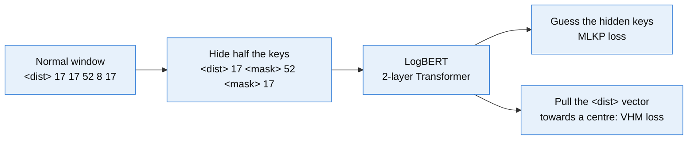
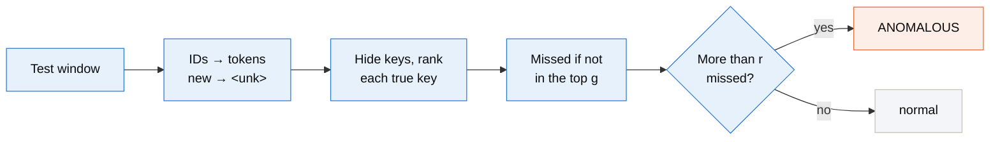
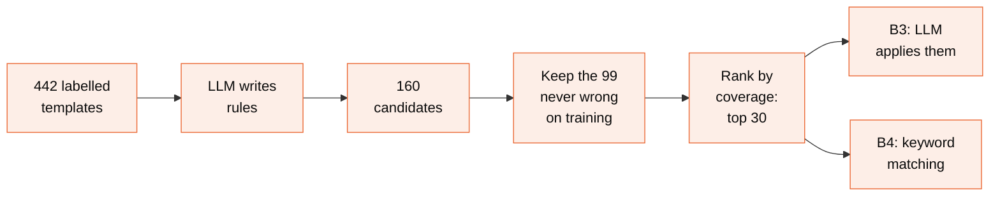
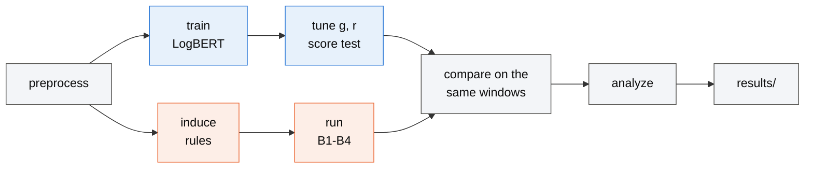

# Slide diagrams (Mermaid source)

The diagrams of `presentation.pptx`, drawn wide for 16:9 slides. `render_diagrams.js` renders every
block named with a `<!-- diagram: name -->` comment to `diagrams/<name>.png`. The guide
(`docs/guide.md`) has fuller versions of the same diagrams.

Classes: `a` for Approach A (blue), `b` for Approach B (orange), `shared` for steps both use.

<!-- diagram: logbert-train -->

<!-- diagram: logbert-detect -->

<!-- diagram: logrules -->

<!-- diagram: run-flow -->

